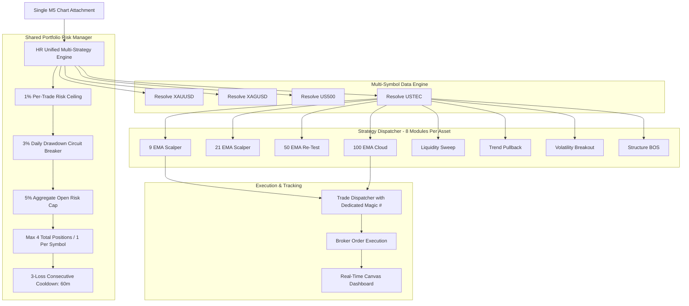

# HR UNIFIED MULTI-STRATEGY TRADING SYSTEM — PRODUCTION DEPLOYMENT & ARCHITECTURE MANUAL

**Document Version:** 1.0.0  
**Release Target:** MT5 Build 6230+ / Exness-MT5Trial8 & Demo Accounts  
**Primary Binary:** `00_UNIFIED_SYSTEM/HR_UNIFIED_MULTI_STRATEGY_EA.mq5` (`.ex5`)  
**Repository:** `HR-Professional-Services/HemanthRanam-MT5-EAs`  

---

## 1. System Overview & Core Philosophy

The **HR Unified Multi-Strategy Trading System** is an institutional-grade, single-chart multi-instrument Expert Advisor designed to execute up to eight distinct quantitative strategy modules across four asset classes simultaneously:

1. **Gold (`XAUUSD`)** — Precious Metals Spot
2. **Silver (`XAGUSD`)** — High-Beta Metals Spot
3. **S&P 500 (`US500`)** — US Broad Equity Index
4. **Nasdaq 100 (`USTEC`)** — US Technology Growth Equity Index

### Architectural Paradigm: Single-Chart Attachment
Unlike conventional MetaTrader EAs that require attaching separate instances to individual charts, the HR Unified EA is attached to **any single chart** (e.g., `USTEC M5`). It uses non-blocking asynchronous multi-symbol data copying (`CopyRates`, `CopyBuffer`, `CopyTickVolume`), decoupled per-symbol bar tracking (`SERIES_LASTBAR_DATE`), and independent strategy dispatchers.

---

## 2. Integrated Strategy Module Catalog

The unified system merges the eight independently researched trading methodologies from the repository:

| ID | Strategy Module | Defining Mechanism | Timeframe | Indicators Used |
| :---: | :--- | :--- | :---: | :--- |
| **S1** | **9 EMA Momentum Scalper** | Closed-bar EMA 9 reclaim with HTF H1 trend filter & volume confirmation | M5 (H1 Bias) | EMA 9, H1 EMA 9, ATR 14, Volume SMA 20 |
| **S2** | **21 EMA Pullback Scalper** | Intermediate pullback resumption after value zone test | M5 (H1 Bias) | EMA 21, H1 EMA 21, ATR 14, Volume SMA 20 |
| **S3** | **50 EMA Trend Re-Test** | Major intraday trend re-test and structural rejection | M5 (H1 Bias) | EMA 50, H1 EMA 50, ATR 14, Volume SMA 20 |
| **S4** | **100 EMA Regime Cloud** | Dynamic wick-bounce and trend continuation engine | M5 (H1 Bias) | EMA 100, H1 EMA 100, ATR 14, Volume SMA 20 |
| **S5** | **Liquidity Sweep Reversal** | Failed breakout past 24-bar swing extremes with rapid reclaim displacement | M5 | Swing High/Low Fractal, ATR 14 Buffer |
| **S6** | **Trend Pullback Continuation** | 9/21 EMA value corridor touch in strong EMA 200 trend | M5 | EMA 9, EMA 21, EMA 200, ATR 14 |
| **S7** | **Volatility Expansion Breakout**| Range compression squeeze breakout with volume expansion | M5 | 20-bar Consolidation Box, ATR 14, Volume |
| **S8** | **Market Structure Momentum** | High-conviction Break of Structure (BOS) with RSI momentum | M5 | Swing Pivots, RSI 14, Structure Lookback |

---

## 3. Evidence-Based Configuration & Allocation Matrix

Following the multi-year empirical findings from **Phases 7, 8, 9, 10, and 11**, the 32 strategy–instrument combinations are categorized as follows:

| Asset | Default State | Enabled Strategies by Default | Disabled / Research Strategies | Empirical Rationale |
| :--- | :---: | :--- | :--- | :--- |
| **USTEC** | **ACTIVE** | S1 (9 EMA), S2 (21 EMA), S3 (50 EMA), S4 (100 EMA), S5 (Sweep), S6 (Pullback), S7 (VolBreakout), S8 (BOS) | None | Highest historical expectancy across 2021–2026. S1 showed PF 6.80 in 2026; S4 showed +$11.8k in Discovery. |
| **US500** | **ACTIVE** | S1 (9 EMA), S5 (Sweep), S6 (Pullback), S7 (VolBreakout), S8 (BOS) | **S2 (21 EMA), S3 (50 EMA), S4 (100 EMA)** | S2 suffered severe whipsaw and $4,800+ commission churn in 2025–2026 chop. S3 & S4 have delayed entries. S1 preserves the verified 1,000pt stop ceiling. |
| **XAUUSD** | **ACTIVE** | S1 (9 EMA), S4 (100 EMA), S5 (Sweep), S6 (Pullback), S7 (VolBreakout), S8 (BOS) | **S2 (21 EMA), S3 (50 EMA)** | Gold 2026 headline win rates were based on tiny samples (4–7 trades). Spread filter realigned to 75 pts to avoid over-filtering. S2 & S3 disabled until higher sample size established. |
| **XAGUSD** | **DISABLED** | None | **ALL (S1 through S8)** | All Silver EAs generated persistent losses (-$6k to -$9k) across 2021–2026. Broker commissions account for >170% of gross losses. **Default OFF.** Opt-in research only. |

---

## 4. Shared Portfolio Risk Manager Safeguards

The central risk manager evaluates every signal at the portfolio level before routing an order to the broker:

1. **1.0% Per-Trade Risk Ceiling:**
   - Every order calculates volume via `OrderCalcProfit` or tick-value formula using the normalized structural stop-loss.
   - If lot rounding causes risk to exceed 1.05% of account equity, volume is decremented by `SYMBOL_VOLUME_STEP`.
2. **3.0% Daily Drawdown Circuit Breaker:**
   - Equity is benchmarked at 00:00 server time.
   - If current equity falls $\ge 3.0\%$ below the start-of-day equity, all further entries are halted for the rest of the day.
3. **5.0% Aggregate Open Risk Cap:**
   - The open risk across all positions owned by the EA is summed.
   - If adding a new position would push aggregate open risk beyond 5.0%, the order is rejected.
4. **Position Concurrency Limits:**
   - Maximum 4 concurrent open positions portfolio-wide.
   - Maximum 1 concurrent open position per symbol to eliminate overlapping directional exposure.
5. **Consecutive Loss Cooldown Throttle:**
   - If 3 consecutive losses are booked on closed trades today, a 60-minute hard trading lockout is activated to prevent revenge trading during adverse market regimes.
6. **Execution Integrity & Stop Normalization:**
   - Every price, SL, and TP is strictly normalized to `SYMBOL_TRADE_TICK_SIZE`.
   - Broker stop and freeze levels are verified before submission.
   - Asset-specific SL ceilings (Gold: 1,500 pts; US500: 1,000 pts; USTEC: 7,500 pts) prevent catastrophic stops on volatility spikes.

---

## 5. Magic Number Architecture & Position Ownership

To avoid collisions with manual trades or other EAs, the unified system uses a deterministic namespace:

$$\text{Magic} = \text{InpMasterMagicBase (900000)} + (\text{SymbolIndex} \times 10) + \text{StrategyIndex}$$

| Symbol | Symbol Index | Strategy Module | Module Magic Number | Order Comment |
| :--- | :---: | :--- | :---: | :--- |
| **XAUUSD** | 0 | S1: 9 EMA Scalper | `900000` | `HR_XAUUSD_9EMA` |
| **XAUUSD** | 0 | S5: Liquidity Sweep | `900004` | `HR_XAUUSD_LIQSWP` |
| **XAGUSD** | 1 | S1: 9 EMA Scalper | `900010` | `HR_XAGUSD_9EMA` |
| **US500** | 2 | S1: 9 EMA Scalper | `900020` | `HR_US500_9EMA` |
| **US500** | 2 | S5: Liquidity Sweep | `900024` | `HR_US500_LIQSWP` |
| **USTEC** | 3 | S1: 9 EMA Scalper | `900030` | `HR_USTEC_9EMA` |
| **USTEC** | 3 | S4: 100 EMA Cloud | `900033` | `HR_USTEC_100EMA` |
| **USTEC** | 3 | S8: Structure BOS | `900037` | `HR_USTEC_STRMOM` |

> [!IMPORTANT]
> **Standalone EA Coexistence Guard:**
> Never run the standalone EAs (`9_EMA_EA`, `LIQUIDITY_SWEEP_REVERSAL_EA`, etc.) on the same demo account alongside `HR_UNIFIED_MULTI_STRATEGY_EA.mq5` without verifying their magic numbers. If standalone EAs share magic numbers, the unified portfolio risk manager will count their open positions toward the 4-position and 5% risk caps.

---

## 6. Pre-Packaged Preset Files

Three `.set` configuration files are available in `Presets/`:

1. `Presets/HR_UNIFIED_FULL_PORTFOLIO_DEMO.set`:
   - All recommended candidates enabled across Gold, S&P 500, and Nasdaq.
   - Silver disabled.
   - Risk: 0.5% per trade, 3% daily DD limit, 5% portfolio risk cap.
2. `Presets/HR_UNIFIED_CONSERVATIVE_CORE.set`:
   - Ultra-conservative demo mode.
   - Enables strictly three evidence-supported modules: **Nasdaq 100 (USTEC) 9 EMA**, **Nasdaq 100 (USTEC) 100 EMA**, and **S&P 500 (US500) 9 EMA**.
   - Explicitly disables Gold (XAUUSD), Silver (XAGUSD), all Liquidity Sweeps, and all other 29 strategy-symbol combinations.
   - **Intentional 2-Position Portfolio Cap:** While three modules are actively scanning, a maximum of 2 positions may be open simultaneously across the portfolio (`InpMaxTotalOpenPositions=2`, `InpMaxPositionsPerSymbol=1`), preventing over-concentration if multiple signals trigger concurrently.
   - Risk: 0.5% per trade, 2% daily DD limit, 3% portfolio risk cap.
3. `Presets/HR_UNIFIED_SILVER_RESEARCH.set`:
   - Experimental opt-in preset for Silver research.
   - Risk restricted to 0.25% per trade; 120-minute post-loss cooldown.

---

## 7. Demo-Account Deployment Checklist

Follow these steps when attaching to a MetaTrader 5 demo account:

1. **Verify Terminal Version:** MetaTrader 5 Build 6200 or higher.
2. **Compile EA:** Open MetaEditor 64 and compile `00_UNIFIED_SYSTEM/HR_UNIFIED_MULTI_STRATEGY_EA.mq5` (verify 0 errors, 0 warnings).
3. **Select Execution Chart:** Open any **M5 chart** (recommended: `USTEC` or `US500`).
4. **Attach Expert Advisor:** Drag `HR_UNIFIED_MULTI_STRATEGY_EA` onto the chart.
5. **Enable Algo Trading:**
   - In MT5 toolbar, ensure **Algo Trading** button is green.
   - In the EA inputs dialog, check **Allow Algo Trading**.
6. **Load Desired Preset:**
   - Click **Inputs** -> **Load**.
   - For focused conservative evaluation: select `Presets/HR_UNIFIED_CONSERVATIVE_CORE.set` (isolates USTEC 9 EMA, USTEC 100 EMA, US500 9 EMA).
   - For full portfolio scanning: select `Presets/HR_UNIFIED_FULL_PORTFOLIO_DEMO.set`.
7. **Verify Broker Symbols:**
   - Observe the on-chart dashboard.
   - Verify that all active assets show `READY 🟢` or `STANDBY 🟡` and that broker mappings (e.g., `USTECm`, `US500m`) are resolved.
8. **Emergency Stop Procedure:**
   - To immediately halt all new trading without modifying open positions: Set `InpMasterTradingEnable = false`.
   - To immediately flatten all EA-owned positions: Click MT5 Algo Trading OFF, or right-click position in Trade tab -> Close Position.

