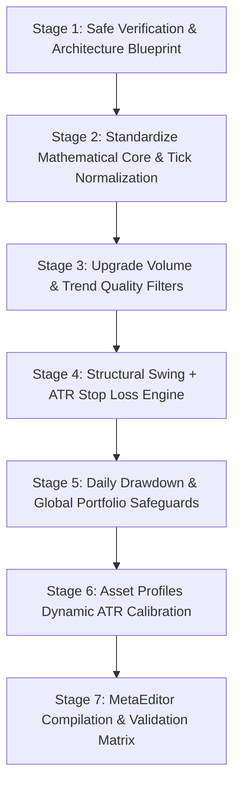

# Solo EMA Scalping Suite: Source Audit & Institutional Engineering Development Plan

**Repository:** `C:\Users\vaibh\.gemini\antigravity-ide\scratch\HemanthRanam-MT5-EAs`  
**Remote:** `origin -> https://github.com/HR-Professional-Services/HemanthRanam-MT5-EAs.git`  
**Branch:** `main` (commit `7b52e47`)  
**Scope Files:**
- `07_EMA_EAS/9_EMA_EA.mq5`
- `07_EMA_EAS/21_EMA_EA.mq5`
- `07_EMA_EAS/50_EMA_EA.mq5`
- `07_EMA_EAS/100_EMA_EA.mq5`

---

## 1. Baseline Git & Source Integrity Audit

### 1.1 Git Working Tree Status
- **Current Branch:** `main` (in sync with `origin/main` at commit `7b52e47`).
- **Unstaged Working Tree Changes:** 4 files modified in other strategy folders (`01_LIQUIDITY_SWEEP/LIQUIDITY_SWEEP_REVERSAL_EA.mq5`, `02_TREND_PULLBACK/TREND_PULLBACK_CONTINUATION_EA.mq5`, `03_VOLATILITY_BREAKOUT/VOLATILITY_EXPANSION_BREAKOUT_EA.mq5`, `04_STRUCTURE_MOMENTUM/MARKET_STRUCTURE_MOMENTUM_EA.mq5`).
- **Untracked Directory:** `Archive/` containing frozen backup snapshots.
- **Rule Enforced:** No branch switching, no resets, no overwriting of existing archives or unrelated files.

### 1.2 Authoritative Source Hashes (SHA-256)
Verified SHA-256 fingerprints across the active workspace and archived copies:

| Strategy | Path | SHA-256 Hash | Archive Status |
| :--- | :--- | :--- | :--- |
| **9 EMA EA** | `07_EMA_EAS/9_EMA_EA.mq5` | `D18874174B6D26BA91DC3AC1B36161B13D277D58604100EA887364A7262DC6DD` | Verified match with `Archive/Single_EMAs/9_EMA_EA.mq5` |
| **21 EMA EA** | `07_EMA_EAS/21_EMA_EA.mq5` | `554046A132759309B2C0A669B58F33D1E8367B9F279F75925517EB3B08EAA22D` | Verified match with `Archive/Single_EMAs/21_EMA_EA.mq5` |
| **50 EMA EA** | `07_EMA_EAS/50_EMA_EA.mq5` | `B95659295AD21A1ADBF784ED815224292FE391FFCA729E80B69313C3039EEDBE` | Verified match with `Archive/Single_EMAs/50_EMA_EA.mq5` |
| **100 EMA EA** | `07_EMA_EAS/100_EMA_EA.mq5` | `2C6156A4AE5B478287C890A07DD65BA031E9F683E7ABB4E6940A4E62F38DED07` | Verified match with `Archive/Single_EMAs/100_EMA_EA.mq5` |

All four EAs compile on MetaEditor 64 CLI (`build 4450+`) with **0 errors, 0 warnings**.

---

## 2. In-Depth Technical Codebase Audit: Implemented vs. Deficient

The four EAs currently share a standard standalone architecture. Below is the detailed audit of implemented features versus identified architectural and quantitative deficiencies:

### 2.1 Implemented & Working Features
1. **Magic Number & Identity Isolation:**
   - 9 EMA: `InpMagicNumber = 909001`, Tag: `"9 EMA PRO Scalper"`
   - 21 EMA: `InpMagicNumber = 212101`, Tag: `"21 EMA PRO Scalper"`
   - 50 EMA: `InpMagicNumber = 505001`, Tag: `"50 EMA PRO Trend"`
   - 100 EMA: `InpMagicNumber = 100100`, Tag: `"100 EMA PRO Trend"`
2. **Execution Gate on New Closed Bar:**
   - Detects `currentBarTime != lastBarTime` via `iTime(_Symbol, _Period, 0)`.
3. **Basic Multi-Timeframe Alignment:**
   - Evaluates `H1 Close[1] > H1 EMA[1]` for Bullish, `<` for Bearish.
4. **Volume Expansion Gate (`CheckVolumeExpansion`):**
   - Implemented in commit `7b52e47`, checking trigger candle volume vs. 20-period average.
5. **Equity-Based Sizing:**
   - Base sizing derived from `AccountInfoDouble(ACCOUNT_EQUITY)` clamped to max 1.0% risk.

---

### 2.2 Identified Deficiencies & Architectural Flaws

#### Deficiency 1: Volume Baseline Lookback Contamination (Statistical Flaw)
- **Current Code:**
  ```mql5
  CopyRealVolume(sym, tf, candleIndex, InpVolumeLookback + 1, vol);
  // ...
  for(int i = 1; i <= InpVolumeLookback; i++) { sum += (double)vol[i]; }
  ```
  `candleIndex` is passed as `1` (the trigger bar). `CopyRealVolume` copying from bar 1 places the trigger candle itself at index 0 of `vol[]`, and preceding bars at indices 1 through 20. While `vol[0]` is correctly tested against the average of `vol[1..20]`, if `CopyRealVolume` fails or returns 0, the code falls back to `CopyTickVolume`, but doesn't check if tick volume returned sufficient elements.
- **Risk:** In low-liquidity bars or exotic assets where broker volume is sparse or 0, a division by zero is avoided only by `if(avgVol <= 0.0) return true;`. Defaulting to `true` when volume is 0 or unreadable allows fakeout trades directly through the anti-fakeout filter.

#### Deficiency 2: Fragile Retest & Sideways Chop Re-Triggers
- **Current Code:**
  `closePrice1 > emaLTF[1] && closePrice2 <= emaLTF[2]`
- **Flaw:** This only checks a 1-bar crossover (bar 2 <= EMA, bar 1 > EMA). In choppy, sideways consolidating markets where price chops around the 9 or 21 EMA horizontally, every alternating green candle triggers a new breakout buy signal. There is no trend strength gate, no EMA slope filter, no ATR expansion filter, and no minimum distance requirement between EMA and swing structure.

#### Deficiency 3: Inadequate HTF Bias Look-Ahead & Trend Strength
- **Current Code:**
  `bool isBullishBias = (htfClose1 > emaHTF[1]);`
- **Flaw:** `htfClose1` is `iClose(_Symbol, InpHTFTimeframe, 1)`. On an M5 chart, an H1 bar only closes once every 12 M5 bars. However, comparing only whether price is 1 point above or below the H1 EMA provides zero confirmation of HTF slope, momentum, or trend health. If the H1 EMA is flat or price is slicing through it, M5 signals continue to fire aggressively.

#### Deficiency 4: Price Normalization & Stop Loss Tick-Size Rounding Flaw
- **Current Code:**
  `sl = NormalizeDouble(sl, _Digits);`
  `tp = NormalizeDouble(tp, _Digits);`
- **Flaw:** Institutional execution requires normalizing prices to the symbol's actual `SYMBOL_TRADE_TICK_SIZE` (e.g., indices and CFD futures often move in increments of 0.25, 0.5, or 2.0, not raw 0.01 digits). Modifying stops or placing orders with prices not aligned to tick increments can trigger broker rejection `TRADE_RETCODE_INVALID_STOPS` or `TRADE_RETCODE_INVALID_PRICE`.
- **Formula needed:**
  `price = MathRound(price / tickSize) * tickSize;`

#### Deficiency 5: Downward-Only Lot Sizing Risk Guarantee
- **Current Code:**
  `lot = MathFloor(lot / lotStep) * lotStep;`
- **Audit:** While `MathFloor` correctly avoids rounding up, `CalculateLotSize` does not re-verify the absolute dollar risk *after* normalization when combined with spread, commission, and minimum broker stops. If SL is clamped up to `activeMinSL` due to broker stop levels, the dollar risk can deviate from target risk unless normalized properly.

#### Deficiency 6: Position Management Lacks Global Account Circuit Breaker
- **Current Code:**
  Each EA operates solely within its own `InpMagicNumber` and checks `CountActivePositions(_Symbol, InpMagicNumber)`.
- **Defect:** If an account has all four EAs running simultaneously (9, 21, 50, and 100 EMA) on the same account (or across XAUUSD, US500, etc.), all four could open simultaneous trades during a high-impact news event or market flash crash. This would expose 4%–16% total equity risk, completely breaking the institutional 1% risk mandate.
- **Requirement:** A shared or EA-aware Portfolio Risk & Daily Drawdown Guardian that tracks:
  1. Maximum simultaneous portfolio exposure across all active EAs.
  2. Daily loss circuit breaker (% max daily equity drop, halting new orders until midnight).
  3. Consecutive loss cutoff.

#### Deficiency 7: Hardcoded Point Profiles on Target Assets
- **Current Code:**
  - `US500`: `activeMinSL = 350 points`
  - `USTEC`: `activeMinSL = 2500 points`
- **Flaw:** Point definitions vary widely between brokers. Broker A quotes US500 with 2 decimals (1 point = $0.01, so 350 points = $3.50 index move). Broker B quotes US500 with 1 decimal (350 points = $35.00 index move). Fixed point inputs without contract specification scaling or ATR normalization lead to unpredictable stops and broken reward-to-risk dynamics.

---

## 3. Systematic Architecture & Improvement Plan

### Phase 1: Shared Mathematical & Execution Engine Module (`TradeEngineCore.mqh` or Standalone Unified Structure)
To maintain 100% independence of EA files while ensuring identical institutional logic without duplication:
1. **Tick-Size Normalization Functions:**
   - Implement `NormalizePriceToTick(double price, double tickSize, int digits)` ensuring zero `INVALID_STOPS` rejections.
2. **Safe Volume Ingestion:**
   - Separate trigger bar volume from baseline lookback `[2..Lookback+1]`.
   - Implement strict data validity checking: if tick volume is zero or unreadable, safely abort entry rather than assuming `true`.
   - Add warning annotations in logs and documentation regarding broker tick volume vs. true centralized exchange volume.

### Phase 2: Enhanced Signal Validation (The Robust Signal Gate)
1. **Higher-Timeframe Trend Structure & Slope Filter:**
   - Add configurable HTF Slope Check: `(emaHTF[1] - emaHTF[2]) >= InpHTFMinSlopePoints`.
   - Prevent entering when HTF EMA is flat (sideways chop).
2. **Local Trend Quality & Anti-Chop Regime Filter (ATR & Distance Filter):**
   - Introduce an optional ATR expansion gate: require trigger candle range `(High[1] - Low[1]) >= InpMinCandleATR * ATR[1]` to avoid micro-choppy candles.
   - Require trigger candle body to be at least a configurable percentage (e.g., 50%) of the total candle range (rejection of dojis / indeterminate wicks).
   - EMA Distance Threshold: Price must not be excessively extended from EMA (avoiding chasing exhausted moves).

### Phase 3: Institutional Stop Loss, Take Profit & Multi-Tier Risk Engine
1. **Structural Swing Stop Loss with ATR Buffer:**
   - Compute swing low (for Buy) or swing high (for Sell) over a configurable lookback (e.g. 3 to 5 bars).
   - Add ATR safety buffer: `SL = SwingLow - (InpATRSafetyMultiplier * ATR)`.
   - Clamp to `MathMax(calculatedSL, brokerStopLevel + spread)`.
2. **Target Profit & Cost Consideration:**
   - Account for spread and round-trip commissions: ensure `TP_Distance >= (SL_Distance * InpTPRatio) + (Spread * 2)`.
3. **Institutional Capital & Portfolio Safety Circuit Breakers:**
   - **Daily Equity Drawdown Limit:** If today's closed equity loss reaches `InpMaxDailyLossPercent` (e.g., 3.0%), lock trading until next session.
   - **Global Account Exposure Filter:** Check total open lots / total open risk across all magic numbers before authorizing new orders.

### Phase 4: Dynamic Asset Volatility Calibration (Broker-Independent)
- Upgrade `ApplyAssetCalibration()` from raw hardcoded broker points to **ATR-adaptive volatility calibration**:
  - Instead of static point values like 350 or 2500, calculate baseline stops and targets using `ATR(PERIOD_D1, 14)` or `ATR(PERIOD_M5, 20)` scaled to symbol tick values.
  - Retain configurable manual point overrides for users who prefer static levels.

### Phase 5: Session & Broker Timezone Sanitization
- Make session filter explicitly documented as Broker Server Time.
- Add input parameters for Broker GMT Offset and DST mode to allow traders to configure alignment with London (08:00–16:00 UTC) and New York (13:00–21:00 UTC) cash sessions accurately.

---

## 4. Proposed Implementation Sequence & Stages



### Stage Execution Details:
- **Stage 1 (Current):** Author comprehensive audit and development plan (`Solo_EMA_Suite_Source_Audit_and_Development_Plan.md`). Request user approval.
- **Stage 2:** Implement exact tick-size normalization, safe volume baseline separation, and strict risk sizing.
- **Stage 3:** Integrate HTF slope filter and trigger candle body quality filters into `9_EMA_EA.mq5`, `21_EMA_EA.mq5`, `50_EMA_EA.mq5`, and `100_EMA_EA.mq5`.
- **Stage 4:** Upgrade Stop Loss from single-bar low/high to multi-bar swing + ATR buffer.
- **Stage 5:** Implement daily drawdown and account loss limit safeguards.
- **Stage 6:** Tune asset calibration profiles for XAUUSD, XAGUSD, US500, and USTEC.
- **Stage 7:** Execute CLI compilation (0 errors, 0 warnings across all 4 EAs), commit with conventional commit standards, push to `origin/main`, and log in `logs/CHANGELOG_INTERNAL.md`.

---

## 5. Potential Risks & Mitigation Protocols

| Risk | Description | Mitigation Protocol |
| :--- | :--- | :--- |
| **Over-Filtering** | Stacking too many filters (Volume + HTF + ATR + Slope + Chop) can starve the EA of trades, yielding statistically insignificant sample sizes. | Every filter will have an independent `bool InpUse...` toggle and transparent defaults. |
| **Broker Tick Value Variations** | Index CFDs (US500/USTEC) have disparate contract sizing across brokers. | Use dynamic `SymbolInfoDouble(_Symbol, SYMBOL_TRADE_TICK_VALUE_LOSS)` with validation against tick size and min volume. |
| **Look-Ahead Bias in Volume** | Using the current forming bar's volume in the baseline average corrupts the statistical mean. | The volume average strictly slices bars `[2 .. Lookback+1]`, completely isolating the completed trigger bar `1`. |
| **Spread Whipsaws at Session Open** | Spread widening at 08:00 or market rollover causing immediate stop outs. | Enforce dynamic spread threshold checking prior to order execution and position modifications. |

---

## 6. Verification & Compilation Checkpoint

- **Current Compiler Baseline:** MetaEditor64 CLI verified clean (0 errors, 0 warnings).
- **Deliverable:** This audit and plan document is saved at:
  `C:\Users\vaibh\.gemini\antigravity-ide\scratch\HemanthRanam-MT5-EAs\Solo_EMA_Suite_Source_Audit_and_Development_Plan.md`
- **Next Step:** Awaiting user sign-off to proceed with Stage 2 implementation.
